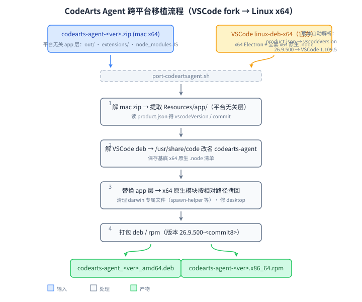

# CodeArts Agent — 跨平台移植脚本（port-codeartsagent.sh）

> 将华为 CodeArts Agent（VSCode fork）移植到 **Linux x64**，重新打包为 **deb / rpm**。
> 官方仅提供 macOS (x64 zip) / Windows (x64 exe) / Linux (**arm64** deb)，无 x64 Linux 包。
>
> 本案例是 [port-linux](../README.md) 移植工具集收录的移植方案之一。

## 移植原理

CodeArts Agent 上游是 VSCode（`product.json` 中 `vscodeVersion` 标明基线，如
`26.9.500 → 1.109.5`）。VSCode 的应用层（`resources/app/`：`out/`、`extensions/`、
`node_modules` 的 JS 部分）是**平台无关**的；平台差异集中在两处：

1. **Electron 运行时**（darwin / linux 二进制）；
2. **原生 Node 模块**（`node-pty`、`@vscode/sqlite3`、`@vscode/spdlog`、
   `native-keymap`、`@parcel/watcher` 等的 `.node` 文件）。

因此本方案**不重编译任何东西**——直接用 VSCode 官方 linux-deb-x64 作为运行时
基底，把 CodeArts 的 app 层套上去，再把基底里的 x64 原生模块按相对路径拷回：



已验证（26.9.500）：mac zip 与 arm64 deb 的 app 层在剔除架构文件后**完全一致**
（`out/main.js` md5 相同），证明 app 层确实平台无关；VSCode 基底的
`node_modules` 树与 CodeArts 的同名模块版本一致（如 `node-pty 1.2.0-beta.10`），
`.node` 可直接替换。

安装布局（与 VSCode deb 一致，仅改名）：

```
/usr/share/codearts-agent/     # Electron + resources/app（CodeArts 层 + x64 .node）
/usr/bin/codearts-agent        # CLI 入口（原 /usr/bin/code）
/usr/share/applications/codearts-agent.desktop
/usr/share/icons/hicolor/*/apps/codearts-agent.png
```

## 用法

```bash
# 最简：自动探测当前目录 codearts-agent-*.zip，VSCode 基底自动下载，按当前 OS 打包
./port-codeartsagent.sh

# 同时生成 deb 和 rpm
./port-codeartsagent.sh -p all

# 显式指定 mac 源 zip
./port-codeartsagent.sh -p deb codearts-agent-26.9.500.zip

# 指定本地 VSCode deb 基底（默认按 vscodeVersion 从 update.code.visualstudio.com 下载）
./port-codeartsagent.sh -v ~/Downloads/code_1.109.5-1746012053_amd64.deb
```

### 参数

| 参数 | 说明 |
|---|---|
| `-p, --platform rpm\|deb\|all` | 构建目标；省略时按当前 OS 自动检测 |
| `-m, --source PATH\|URL` | mac zip（`codearts-agent-<ver>.zip`）；省略时自动探测当前目录 |
| `-v, --vscode PATH\|URL` | VSCode 官方 linux-deb-x64 包；省略时按 `vscodeVersion` 自动下载 |
| `<*.zip>` | 位置参数：等价 `-m` |

### 版本自动解析

- **CodeArts 版本与 commit**：读 mac zip 内 `app/package.json` 的 `version`
  与 `product.json` 的 `commit`，产物命名为 `codearts-agent_<ver>-<commit8>_amd64.deb`；
- **VSCode 基线版本**：读 `product.json` 的 `vscodeVersion`（`26.9.500 → 1.109.5`），
  据此下载 `https://update.code.visualstudio.com/<ver>/linux-deb-x64/stable`。

## 产物

```
build/
├── cache/   # VSCode deb 下载缓存，跨次复用
├── work/    # mac app 层解压、payload 合成树，跨次复用
└── out/
    ├── codearts-agent_<ver>-<commit8>_amd64.deb
    └── codearts-agent-<ver>-1.<commit8>.x86_64.rpm
```

安装：

```bash
# Debian/Ubuntu
sudo apt install ./codearts-agent_*.deb

# Fedora/RHEL
sudo dnf install ./codearts-agent-*.rpm
```

安装后从应用菜单启动 CodeArts Agent，或终端运行 `codearts-agent`。

## 依赖

```bash
# Fedora
sudo dnf install unzip tar nodejs curl rpm-build

# Debian/Ubuntu
sudo apt install unzip tar nodejs curl dpkg-dev
```

- `unzip`、`tar`：解压源包
- `node`：读 `package.json` / `product.json` 版本信息
- `curl` 或 `wget`：下载 VSCode 基底
- `dpkg-deb`（或 `ar`）：解 VSCode deb / 打 deb（缺失则跳过 deb）
- `rpmbuild`：打 rpm（缺失则跳过 rpm）

> 与 workbuddy 方案不同，本方案**不需要 `npx asar`**——VSCode 系应用不走
> app.asar 打包，app 层是明文目录，直接替换即可。

## 已知限制

- 仅支持 x86_64（amd64）；arm64 请直接用官方 deb。
- **智能体（Agent）功能不可用**：AgentKernel 服务二进制（`agentkernelServer-<platform>-<arch>`）
  华为发布了 `darwin-arm64` / `darwin-x64` / `linux-arm64` 三个架构版本（mac zip、
  IDE 内置、marketplace vsix `HuaweiCloud.vscode-codebot` 各带其一），但**无 linux-x64
  版本**——已逐一验证三个渠道均取不到（含旧版 vsix 26.3.6：该版本为老架构，
  完全不含 kernel 管理，只有跨平台的 ripgrep，无 server 二进制）。IDE 本体
  （编辑、构建、调试、终端）可正常使用，但 AI 智能体对话会报
  `server file not exists: ~/.codeartsdoer/.../AgentKernel_*`。
- VSCode 基底的扩展兼容性依赖 `product.json` 中的扩展 ID 与版本约束；
  CodeArts 私有扩展（`huaweicloud.*`）随 app 层自带，不受影响。
- 上游 VSCode 基线与 CodeArts 的 node_modules 若出现版本漂移，`.node` 拷回
  时以 VSCode 基底版本为准（ABI 需匹配其 Electron；同基线一般一致）。
- 华为签名校验、自动更新等依赖 macOS/Windows 机制的功能不可用。

## 来源

- 官方产品页：<https://www.huaweicloud.com/product/codearts/ai.html>
- VSCode 官方下载：<https://update.code.visualstudio.com/>
- 移植方式参考：本仓库 [`workbuddy/`](../workbuddy/)（Electron 分层移植）、
  [`deveco-studio/`](../deveco-studio/)（多源重组）

## 许可

打包脚本以 Apache 2.0 许可。CodeArts Agent 应用层基于 MIT 许可的 VSCode
（版权归 Microsoft），华为云扩展与服务归华为或相应权利人所有，本项目与
华为无隶属关系。公开分发前请确认上游条款允许。
