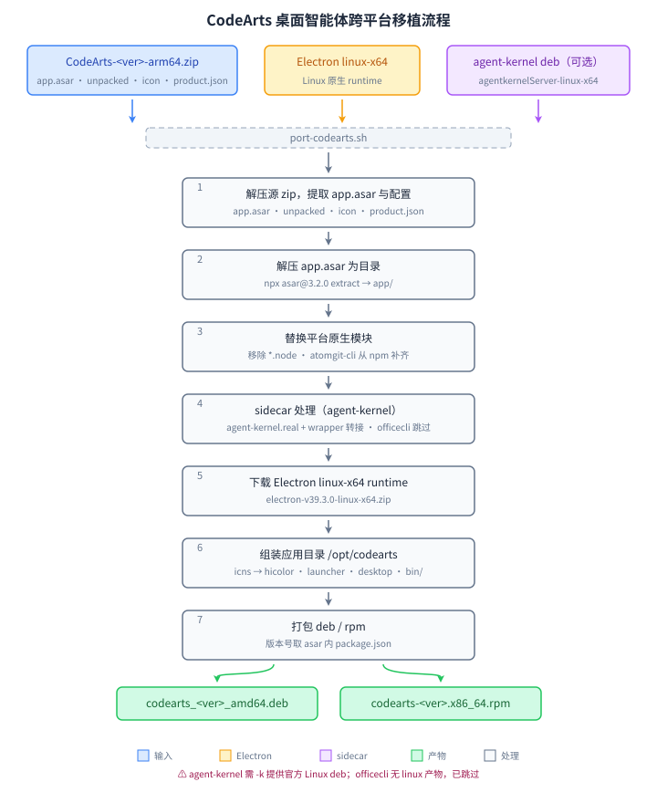

# CodeArts — 跨平台移植脚本（port-codearts.sh）

> 将华为云 CodeArts 桌面端移植到 Linux，重新打包为 **deb / rpm**。
> 上游仅提供 macOS (arm64 zip) / Windows (x64 NSIS exe)，无 Linux 版。
>
> 本案例是 [port-linux](../README.md) 移植工具集收录的移植方案之一。

华为云 CodeArts 桌面端（AI 开发助手，**非** VSCode fork）目前没有官方 Linux
客户端。本脚本下载（或使用本地）macOS 应用资源（`CodeArts-<ver>-arm64.zip`），
解压 `app.asar`，清理 darwin 原生模块，补齐 `atomgit-cli` Linux 构建（如需要），
配置 sidecar（agent-kernel / officecli），用 Electron Linux runtime 启动，
重新打包为 deb / rpm。

> **关于 agent-kernel 来源**：桌面端内置的 agent-kernel 上游无 Linux 构建。
> 脚本从 [CodeArts IDE](https://codearts.huaweicloud.com/download.html) 的
> Linux deb（`codearts-agent-linux-x64-*.deb`，这是 IDE 而非桌面端）内提取
> 同名内核 ELF（`agentkernelServer-linux-x64`）并用 wrapper 做协议转接，
> 详见「已知限制」。

## 移植原理

`port-codearts.sh` 自包含全部逻辑，自动完成从 macOS 源包到 deb/rpm 的全流程
（共 7 步：获取源 → 解压 asar → 替换原生模块 → sidecar 处理 → 下载 Electron → 组装 → 打包）：



应用为 Electron 39.3.0 架构：

```
CodeArts-<ver>-arm64.zip
  └─ CodeArts.app/Contents/Resources/
       ├─ app.asar                (平台无关 JS 业务代码，~283MB)
       ├─ app.asar.unpacked/      (asar 外置文件 + mcp-servers)
       ├─ icon.icns               (应用图标 → 转 hicolor PNG)
       ├─ product.json            (运行时配置，需与 app 同级)
       ├─ cloud-sidecars.yaml     (云端 sidecar 配置)
       ├─ agent-config.yaml       (内核配置)
       └─ bin/.agent-kernel/      (内核纯 JS 插件；0.2.x 起内核自包含，部分版本缺省)
+
Electron v<ver>-linux-x64.zip      (Linux 原生 runtime)
  └─ /opt/codearts/electron/
+
codearts-agent-linux-x64-*.deb 内 agentkernelServer-linux-x64 (可选，需 -k)
  └─ wrapper 转接旧协议 --host-init-stdin → serve + POST /v1/init
=
/opt/codearts/
├── app/                           # 解压后的应用代码
│   ├── product.json               # 从 Resources 根提取
│   ├── cloud-sidecars.yaml
│   ├── agent-config.yaml
│   └── bin/
│       ├── agent-kernel.exe       # wrapper 脚本（协议转接）
│       ├── agent-kernel.real      # Linux 内核 ELF
│       └── .agent-kernel/         # 纯 JS 插件（0.2.x 起内核自包含，可能不存在）
├── app.asar.unpacked/             # asar 外置文件（与 app 同层，按 Electron 约定识别）
└── electron/                      # Electron Linux runtime
/usr/bin/codearts                  # 启动脚本: exec electron app/
/usr/share/applications/codearts.desktop
/usr/share/icons/hicolor/<尺寸>/apps/codearts.png
/usr/share/pixmaps/codearts.png    # 兜底图标
```

关键细节：

- darwin 原生 `.node` 模块直接移除（日志标注），`atomgit-cli` 若被引用则通过 npm 自动补齐 `linux-x64` 构建
- `officecli` 无 linux-x64 上游产物，已跳过

## 用法

```bash
# 最简：自动探测当前目录 CodeArts-*.zip，按当前 OS 打包
./port-codearts.sh

# 同时生成 deb 和 rpm
./port-codearts.sh -p all

# 显式指定源 zip
./port-codearts.sh -p deb CodeArts-0.2.3-arm64.zip
./port-codearts.sh -s ./CodeArts-0.2.3-arm64.zip

# 指定 Linux agent-kernel 来源（否则聊天功能不可用）
./port-codearts.sh -k ./codearts-agent-linux-x64-1.2.3.deb
./port-codearts.sh -k https://example.com/codearts-agent-linux-x64.deb
./port-codearts.sh -k /path/to/agentkernelServer-linux-x64

# 覆盖 Electron 版本（默认 39.3.0，与 CodeArts 内置 Electron Framework 对齐）
./port-codearts.sh -e 39.3.0

# 查看帮助
./port-codearts.sh -h
```

### 参数

| 参数 | 说明 |
|---|---|
| `-p, --platform rpm\|deb\|all` | 构建目标；省略时按当前 OS 自动检测（Fedora/RHEL 系 → rpm，Debian/Ubuntu 系 → deb） |
| `-s, --source PATH\|URL` | 源 zip：本地路径或 `http(s)://` 下载地址；省略时自动探测当前目录 `CodeArts-*.zip`（跳过 `*win32*`） |
| `-e, --electron VERSION` | Electron runtime 版本（默认 `39.3.0`） |
| `-k, --kernel PATH\|URL` | Linux 版 agent-kernel 来源：官方 `codearts-agent-*-linux-x64.deb`（本地路径或下载地址），或直接给内核 ELF 路径；省略时自动探测当前目录 `codearts-agent-linux-x64-*.deb`，缺失则聊天功能不可用 |
| `<*.zip>` | 位置参数：直接传源 zip 路径（等价 `-s`） |
| `-h, --help` | 显示帮助信息；未知选项也会先打印帮助到 stderr 再退出 |

### 环境变量

| 变量 | 说明 |
|---|---|
| `DEBUG=1` | 调试模式（`set -eux`，打印每条命令） |
| `IS_CHINA=1` | 中国网络环境，GitHub 系域名（`github.com` / `raw.githubusercontent.com` / `objects.githubusercontent.com`）下载走 CDN 加速，失败自动回退直连 |
| `CDN=<url>` | CDN 前缀地址（默认 `https://fastfile.asfd.cn/`，自动归一为末尾恰好一个 `/`） |
| `NPM_CONFIG_USERCONFIG` | npm 配置文件路径（默认 `~/.npmrc`），其中的 `registry` 用于 `npx asar` 与 `atomgit-cli` 下载 |
| `NPM_CONFIG_REGISTRY` | npm 镜像地址（`~/.npmrc` 未配置 `registry` 时使用） |

> CDN 仅在 `IS_CHINA=1` 且 URL 命中 GitHub 系域名时生效，其他域名（如 npm registry）不走 CDN。npm 镜像优先取 `~/.npmrc` 的 `registry`，其次取 `NPM_CONFIG_REGISTRY`，命中时导出 `NPM_CONFIG_REGISTRY` 供后续 `npx`/`npm` 共用。

### 版本提取

版本号从文件名提取：`CodeArts-0.2.3-arm64.zip` → `0.2.3`（打包时以
`app.asar` 内 `package.json` 的 `version` 为准，两者一致）。

## 产物

```
build/
├── cache/   # 下载缓存（源 zip、Electron、npm tgz），跨次复用
├── work/    # 中间解压产物，跨次复用
└── out/
    ├── codearts_<ver>_amd64.deb
    └── codearts-<ver>-1.fc<NN>.x86_64.rpm
```

安装：

```bash
# Debian/Ubuntu
sudo apt install ./codearts_*.deb

# Fedora/RHEL
sudo dnf install ./codearts-*.rpm
```

安装后从应用菜单启动 CodeArts，或终端运行 `codearts`。

## 依赖

```bash
# Fedora
sudo dnf install unzip tar nodejs npm curl python3 rpm-build binutils

# Debian/Ubuntu
sudo apt install unzip tar nodejs npm curl python3 dpkg-dev binutils
```

- `unzip`、`tar`：解压 zip / deb
- `node` + `npx`：通过 `asar@3.2.0` 解压 `app.asar`；读版本号
- `python3`：icns → PNG 图标转换
- `curl` 或 `wget`：下载 Electron / 源 zip / 内核 deb
- `ar`（`binutils`）：从 `codearts-agent-*.deb` 提取内核 ELF（仅使用 `-k` 且来源为 deb 时需要）
- `file`：校验内核 ELF 来源（仅 `-k` 直接传入内核 ELF 路径时需要）
- `dpkg-deb`：打 deb（缺失则跳过 deb）
- `rpmbuild`：打 rpm（缺失则跳过 rpm）

npm 依赖（`npx asar`、`@hust-open-atom-club/atomgit-cli-linux-x64@0.7.3`）的下载遵循 `~/.npmrc`
中的 `registry` 镜像（如 npmmirror），也可用 `NPM_CONFIG_REGISTRY` 显式
指定、用 `NPM_CONFIG_USERCONFIG` 更换配置文件路径；镜像下载失败会自动
回退官方源（`registry.npmjs.org`），补齐失败不影响主体功能。

## 下载

| 上游产物 | 平台 / 用途 | 下载地址 |
|---|---|---|
| CodeArts 桌面端 `CodeArts-*.zip`（移植源包） | macOS arm64 | <https://codearts.huaweicloud.com/download.html#section-8> |
| codearts-agent `codearts-agent-linux-x64-*.deb`（提取 `agentkernelServer-linux-x64`） | Linux x64 | <https://codearts.huaweicloud.com/download.html#section-3> |

> 两个链接均来自同一下载页的不同锚点；也可在脚本中直接用 `-s` / `-k` 传入对应直链，脚本会自动下载并缓存。

## 来源

- 官方产品页：<https://www.huaweicloud.com/product/codearts.html>
- CodeArts 下载页：<https://codearts.huaweicloud.com/download.html>

## 已知限制

- **officecli 功能不可用**：该原生 sidecar 上游只发布了 `darwin-arm64`
  （mac zip）与 `win32-x64`（NSIS exe 内 `officecli.exe`）两个平台版本，无
  linux-x64 产物，移植包中已跳过。
- **agent-kernel 走 wrapper 转接**：应用（0.1.26 / 0.2.3 均验证）以旧协议（`--host-init-stdin`）
  拉起内核并把配置写到 stdin；Linux 版内核（取自 CodeArts IDE 的 Linux deb 内
  `agentkernelServer-linux-x64`，opencode 架构）改用 `serve` 子命令并经
  `POST /v1/init` 接收配置。脚本生成同名 wrapper 做协议转接（过滤不兼容参数 →
  serve 启动 → 等健康检查 → 转发 hostInit 到 `/v1/init`）。需 `-k` 或当前目录
  存在 `codearts-agent-linux-x64-*.deb`，否则聊天功能不可用；也支持直接传入内核 ELF 或 URL。
- darwin 原生 `.node` 模块无 Linux 替代，已移除（脚本日志会标注清单）；`atomgit-cli` 若被 `out/` 引用则自动从 npm 补齐 `linux-x64` 变体。
- 上游界面更新可能使兼容补丁失效。
- 仅支持 x86_64（amd64）。
- `process.resourcesPath` 类补丁未做：本应用未发现硬编码 macOS 资源路径；
  若后续版本出现，可参考 [`workbuddy/`](../workbuddy/) 的 sed 补丁方式。

## 许可

打包脚本以 Apache 2.0 许可。CodeArts 应用、商标及资源归华为或相应权利人所有，
本项目与华为无隶属关系。公开分发前请确认上游条款允许。
