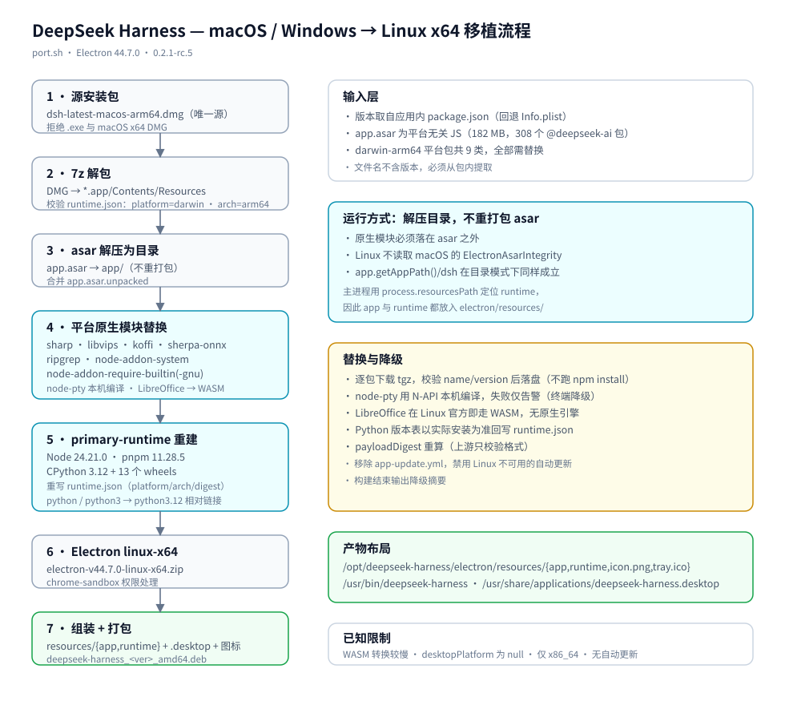

# DeepSeek Harness — 跨平台移植脚本（port.sh）

> 将 DeepSeek Harness 桌面客户端移植到 Linux x64，重新打包为 **deb**（可选 rpm）。
> 上游仅提供 macOS（DMG）与 Windows（x64 NSIS exe），无 Linux 版；
> 本方案固定以 **macOS arm64 DMG** 为唯一源包。
>
> 本案例是 [port-linux](../README.md) 移植工具集收录的移植方案之一。

DeepSeek Harness 是 DeepSeek 的桌面 AI Agent 客户端：Electron 44 外壳 + 内置 dsh
运行时（Node、pnpm、CPython 与 Office/数据科学 wheels）。脚本解包官方 arm64 DMG，
保留平台无关的应用代码，替换平台绑定的原生模块与内置运行时，用 Electron
linux-x64 启动并重打包。

## 下载

上游无 Linux 版，移植源为 macOS arm64 DMG，从官方下载页获取：

**官方下载页**：<https://www.deepseek.com/download/>

在页面中选择 macOS（Apple Silicon / arm64）版本下载，得到 `dsh-latest-macos-arm64.dmg`
（文件名不含版本号，版本由脚本从包内 `package.json` 提取）。也可将下载直链用 `-s`
传给脚本，脚本会自动下载并缓存：

```bash
./port.sh -s https://www.deepseek.com/download/...   # 直链，或直接给本地 .dmg 路径
```

## 移植原理

与只依赖 `app.asar` 的 Electron 应用不同，本应用有**三层**平台相关内容：

1. **应用代码**（`app.asar`，182 MB）：平台无关 JS，但解压后以目录方式运行。
2. **原生模块**（8 类）：sharp、libvips、koffi、sherpa-onnx、ripgrep、
   node-addon-system、node-addon-require-builtin、node-pty、LibreOffice 引擎。
3. **primary-runtime**：随包的 Node 24.21.0、pnpm 11.28.5、CPython 3.12 与
   13 个 Python 包，全部为 darwin/win32 二进制。

移植流程（`port.sh` 自包含全部逻辑）：



```
dsh-latest-macos-arm64.dmg
  └─ *.app/Contents/Resources/
       ├─ app.asar                        平台无关 JS（182 MB）
       ├─ app.asar.unpacked/              asar 外置文件
       ├─ runtime/
       │    ├─ bin/node                   POSIX 包装脚本（跨平台）
       │    ├─ cli/                        CLI 启动器
       │    └─ primary-runtime/            平台绑定的 Node / pnpm / CPython
       ├─ icon.png / icon.icns
       └─ app-update.yml                  (移除)
+
Electron v44.7.0-linux-x64.zip            Linux 原生 runtime
+
npm: 8 类 Linux 等价原生包 + WASM LibreOffice + node-pty 本机编译
+
nodejs.org / python-build-standalone / PyPI wheels
=
/opt/deepseek-harness/
└── electron/
    ├── electron
    ├── chrome-sandbox                   (4755 或 0755)
    └── resources/
        ├── app/                         app.asar 解压目录（含 dsh/）
        ├── runtime/                     重建后的 primary-runtime
        ├── icon.png
        └── tray.ico
/usr/bin/deepseek-harness                启动脚本
/usr/share/applications/deepseek-harness.desktop
/usr/share/icons/hicolor/<尺寸>/apps/deepseek-harness.png
```

> 应用与 runtime 都放在 Electron 的 `resources/` 下，因为主进程用
> `process.resourcesPath` 定位 `runtime/` 与 pnpm，用 `app.getAppPath()`
> 定位 `dsh/`；这样无需 patch 主进程代码。

### 原生模块替换表

| 源包（darwin-arm64） | Linux x64 目标 | 版本 |
|---|---|---|
| `@deepseek-ai/node-addon-system-darwin-arm64` | `@deepseek-ai/node-addon-system-linux-x64` | 0.1.2 |
| `@img/sharp-darwin-arm64` | `@img/sharp-linux-x64` | 0.35.5 |
| `@img/sharp-libvips-darwin-arm64` | `@img/sharp-libvips-linux-x64` | 1.3.4 |
| `@koromix/koffi-darwin-arm64` | `@koromix/koffi-linux-x64` | 3.1.1 |
| `@vscode/ripgrep-darwin-arm64` | `@vscode/ripgrep-linux-x64` | 1.18.0 |
| `node-addon-require-builtin-darwin-arm64` | `node-addon-require-builtin-linux-x64-gnu` | 0.1.9 |
| `sherpa-onnx-darwin-arm64` | `sherpa-onnx-linux-x64` | 1.13.8 |
| `@deepseek-ai/libreoffice-kit-darwin-arm64` | `@deepseek-ai/libreoffice-kit-wasm` | 0.1.5 |
| `node-pty/prebuilds/darwin-arm64` | 本机编译 → `prebuilds/linux-x64/` | 同源版本 |

### primary-runtime 重建

| 组件 | 来源 | 版本 |
|---|---|---|
| Node | nodejs.org `node-v24.21.0-linux-x64.tar.xz` | 24.21.0 |
| pnpm | npm `pnpm@11.28.5`（纯 JS） | 11.28.5 |
| CPython | python-build-standalone `install_only` | 3.12.x（当前 3.12.16） |
| Python 包 | PyPI，按源 `runtime.json` 版本表 | numpy 2.3.5 / pandas 3.0.1 / python-docx 1.2.0 / python-pptx 1.0.2 / openpyxl 3.1.5 / Pillow 12.3.0 / lxml 6.1.3 / XlsxWriter 3.2.9 等 |

重建后 `runtime.json` 与 `dsh/desktop-runtime.json` 的 `platform`/`arch` 改为
`linux`/`x64`，并重算 `payloadDigest`。

## 用法

```bash
# 最简：自动探测当前目录源包，按当前 OS 打包
./port.sh

# 只打 deb
./port.sh -p deb

# 显式指定源安装包（仅 macOS arm64 DMG）
./port.sh -s ./dsh-latest-macos-arm64.dmg

# 覆盖 Electron 版本
./port.sh -e 44.7.0

# 查看帮助
./port.sh -h
```

### 参数

| 参数 | 说明 |
|---|---|
| `-p, --platform deb\|rpm\|all` | 构建目标；省略时按当前 OS 自动检测（Debian 系 → deb，Fedora/RHEL 系 → rpm） |
| `-s, --source PATH\|URL` | 源安装包（macOS arm64 `.dmg`）：本地路径或 `http(s)://` 下载地址；省略时自动探测当前目录的 `dsh-*.dmg`（arm64 优先） |
| `-e, --electron VERSION` | Electron runtime 版本（默认 `44.7.0`） |
| `<*.dmg>` | 位置参数：等价 `-s` |
| `-h, --help` | 显示帮助；未知选项也会先打印帮助到 stderr 再退出 |

### 环境变量

| 变量 | 说明 |
|---|---|
| `DEBUG=1` | 调试模式（`set -eux`） |
| `IS_CHINA=1` | 中国网络环境：GitHub 系域名走 CDN，npm 与 pip 使用镜像 |
| `CDN=<url>` | CDN 前缀（默认 `https://fastfile.asfd.cn/`，自动归一末尾一个 `/`） |
| `NPM_CONFIG_USERCONFIG` | npm 配置路径（默认 `~/.npmrc`） |
| `NPM_CONFIG_REGISTRY` | npm 镜像（`~/.npmrc` 未配置 registry 时使用） |
| `PIP_INDEX_URL` | PyPI 镜像（`IS_CHINA=1` 时默认清华源） |
| `PYTHON_URL` | 覆盖 CPython 发行包 URL（离线或镜像场景） |
| `BUILD_ROOT` | 构建根目录（默认脚本同级 `build/`） |

## 产物

```
build/
├── cache/    # 源包、Electron、npm tgz、Node/Python 发行包、wheels 缓存
├── work/     # 解包、应用目录、primary-runtime、组装与打包中间产物
└── out/
    └── deepseek-harness_<ver>_amd64.deb
```

安装与启动：

```bash
sudo apt install ./deepseek-harness_0.2.1-rc.5_amd64.deb
deepseek-harness
```

CLI：

```bash
/opt/deepseek-harness/electron/resources/runtime/cli/bin/dsh --help
```

## 依赖

```bash
# Debian / Ubuntu（宿主直跑）
sudo apt install 7zip unzip tar nodejs npm python3 curl                  dpkg-dev binutils xz-utils build-essential

# Fedora
sudo dnf install p7zip unzip tar nodejs npm python3 curl rpm-build binutils xz gcc-c++ make
```

- `7z`：解包 DMG
- `node` / `npx`：`asar@3.2.0` 解压与 `node-gyp` 编译 node-pty
- `python3`：JSON 处理与 payload 摘要
- `build-essential`：编译 node-pty（缺失时终端功能降级）
- `dpkg-deb`：打包 deb（缺失时降级 `ar` + `xz`）
- `rpmbuild`：打包 rpm（缺失时跳过）

容器内构建（推荐，基础镜像 `debian:13`）：

```bash
docker run --rm -it -v "$PWD":/work -w /work debian:13 bash -c '
  sed -i "s|deb.debian.org|mirrors.tuna.tsinghua.edu.cn|g" /etc/apt/sources.list.d/debian.sources
  apt-get update
  apt-get install -y --no-install-recommends ca-certificates curl unzip 7zip \
      file nodejs npm python3 xz-utils binutils build-essential
  cd deepseek-harness && ./port.sh -p deb
'
```

## 已知限制

- **LibreOffice 使用 WASM 引擎**：上游未发布 Linux 原生引擎，文档转换走
  `@deepseek-ai/libreoffice-kit-wasm`，大文档转换更慢，字体渲染依赖系统字体。
- **桌面平台标记为 null**：上游 `dsh-base` 仅在 darwin/win32 设置
  `desktopPlatform`，Linux 为 null；账号页面的平台标识可能缺省，不影响登录与对话。
- **窗口外观按 Linux 默认**：主进程的 `titleBarStyle`/`vibrancy` 仅 macOS 生效。
- **无自动更新**：`app-update.yml` 已移除，Linux 无 electron-updater 通道。
- **仅 x86_64 目标**：不产出 arm64 Linux 包。
- **仅 macOS arm64 源**：拒绝 Windows `.exe` 与旧版 `macos-x64.dmg`（脚本读取源包 `runtime.json` 校验 `platform/arch`）。
- **Python 版本差异**：上游声明 3.12.14，实际使用 python-build-standalone 的
  3.12.16；`runtime.json` 记录实际版本，API 兼容。
- **托盘图标**：DMG 源不含 `tray.ico`，使用 `icon.png` 作为托盘图标；GNOME 无扩展时可能不显示。
- **首次启动稍慢**：`__pycache__` 已从包内移除，首次运行会在用户数据目录重建。

## 版本提取

应用安装包文件名不含版本（`dsh-latest-*`）。脚本从解压后的
`package.json` 的 `version` 提取（回退 `Info.plist` 的
`CFBundleShortVersionString`），当前为 `0.2.1-rc.5`。
