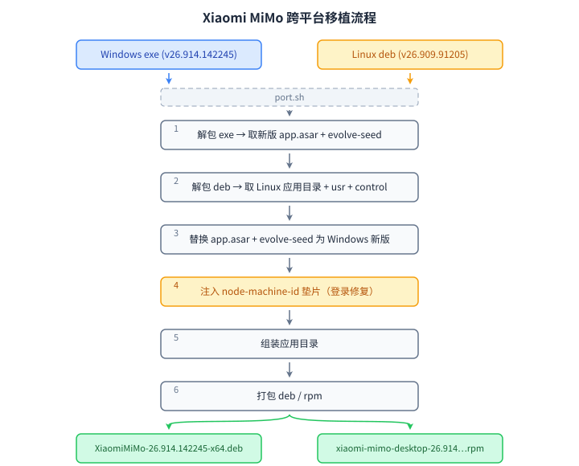

# Xiaomi MiMo 跨平台移植文档

## 背景

两个平台的安装包：

| 包 | 平台 | 架构 | 版本 |
|---|---|---|---|
| `XiaomiMiMo-26.909.91205-x64.deb` | Linux | x86-64 | 26.909.91205（最旧，但作为 Linux 基础） |
| `XiaomiMiMo-26.914.142245-x64-setup.exe` | Windows | x86-64 | 26.914.142245（最新） |

目标：在 Linux x86-64 上使用最新版本 26.914.142245，且登录正常。

## 下载

各平台安装包的直链由官方更新清单统一维护，移植前从清单中取对应平台产物即可：

**更新清单（manifest）**：<https://mimocode-cdn.xiaomimimo.com/mimocode/mimodesktop/manifest.json>

清单中按平台给出最新版直链（`url`）、版本号（`version`）、SHA-256 与文件大小，直接访问即可下载，无需在官网逐级查找：

| 平台 | 产物 | 清单字段 | 直链示例（26.1102.21158） |
|---|---|---|---|
| Linux x64（基底） | `XiaomiMiMo-*.deb` | `platforms["linux-x64"].debUrl` | <https://mimocode-cdn.xiaomimimo.com/mimocode/mimodesktop/XiaomiMiMo-26.1102.21158-x64.deb> |
| Windows x64（移植源） | `XiaomiMiMo-*-setup.exe` | `platforms["win-x64"].url` | <https://mimocode-cdn.xiaomimimo.com/mimocode/mimodesktop/XiaomiMiMo-26.1102.21158-x64-setup.exe> |

> 版本会随官方更新而变化，以清单中返回的 URL 与版本号为准；下载后可对照清单中的 `sha256hash` / `debSha256hash` 校验文件完整性。

## 方案

**采用原版 Linux deb + Windows exe 移植**：
- 原版 deb 提供 Linux 原生层（Electron 框架、`app.asar.unpacked` 原生模块、`runtimes/linux-x64`、`computer-use-linux`）
- Windows exe 提供跨平台层（`app.asar` 业务代码 + `evolve-seed`）
- `port.sh` 内置登录修复（注入 `node-machine-id` 垫片），无需任何外部脚本

## 移植原理

MiMo 是 Electron 应用，天然分层：

```
应用
├── 跨平台层（从 Windows exe 替换）
│   ├── app.asar          ← 业务代码 (JavaScript)
│   └── evolve-seed/      ← AI harness Python 资源
│
├── 平台原生层（保留 Linux deb 原版）
│   ├── xiaomi-mimo-desktop, lib*.so, *.pak, locales  ← Electron 框架
│   ├── app.asar.unpacked/  ← .node 原生模块 (Linux x64 二进制)
│   ├── runtimes/linux-x64/ ← node/python/python-evolve-site 等
│   └── computer-use-linux/ ← Linux 专属
```

移植 = 保留 Linux 原生层 + 用 Windows 最新版替换跨平台层 + 注入登录修复垫片。

## 登录修复

原版 deb 无法登录的根因：`getDeviceId()` 调用 `require("node-machine-id").machineIdSync()`，但 `node-machine-id` 模块未被打包进 `app.asar`，导致设备 ID 获取失败，服务端拒绝登录。

修复方式（内置于 `port.sh` 步骤 4）：解包 `app.asar`，向 `node_modules/node-machine-id/` 注入一个纯 JS 垫片模块，读取 `/etc/machine-id` 或 `/var/lib/dbus/machine-id`，然后重新打包 asar。无需修改二进制或 unpacked 机制，也不依赖任何外部脚本。

> 注意：`asar extract` 对个别跨平台 unpacked 文件（darwin/win32 的 `.node`）报 ENOENT 是预期现象，不影响 Linux 平台文件。

## 一键移植脚本

`port.sh` 自包含全部逻辑，自动完成从源包到 rpm/deb 的全流程：



只需三个文件即可一键移植：`port.sh` + `*.exe` + `*.deb`。

### 用法

```bash
# 依赖
sudo dnf install p7zip binutils tar nodejs rpm-build   # Fedora
# 或 sudo apt install p7zip-full binutils tar nodejs    # Debian/Ubuntu

# 一键移植（自动探测当前目录的 .deb 和 .exe，按当前 OS 选择包格式）
./port.sh

# 指定文件
./port.sh XiaomiMiMo-26.914.142245-x64-setup.exe XiaomiMiMo-26.909.91205-x64.deb

# 指定目标平台: rpm / deb / all
./port.sh -p all      # 同时生成 rpm 和 deb
./port.sh -p rpm      # 仅 rpm
./port.sh -p deb      # 仅 deb
```

### 未来新版本一键移植

当小米发布新 Windows exe 后：

```bash
# 1. 下载新 exe 和对应（或最近）的 Linux deb 到同一目录
#    例如: XiaomiMiMo-26.920.xxxxx-x64-setup.exe
#          XiaomiMiMo-26.918.xxxxx-x64.deb（Linux 版可能仍比 Windows 旧，没关系）

# 2. 运行脚本（自动探测版本号、自动替换、自动修复登录、自动打包）
cd /path/to/packages
./port.sh

# 3. 产出
#    XiaomiMiMo-<新版本>-x64.deb
#    xiaomi-mimo-desktop-<新版本>-1.fc44.x86_64.rpm
```

脚本从文件名提取版本号作为包版本，无需手动指定。

## 产物

| 产物 | 路径 | 大小 |
|---|---|---|
| deb 包 | `XiaomiMiMo-26.914.142245-x64.deb` | 228 MB |
| RPM 包 | `xiaomi-mimo-desktop-26.914.142245-1.fc44.x86_64.rpm` | 242 MB（17068 文件） |
| 移植脚本 | `port.sh` | — |
| 移植文档 | `PORT.md` | — |

## 安装

```bash
# deb（Debian/Ubuntu 系）
sudo apt install -y XiaomiMiMo-26.914.142245-x64.deb
# 或
sudo dpkg -i XiaomiMiMo-26.914.142245-x64.deb

# rpm（Fedora/RHEL 系）
sudo dnf install -y xiaomi-mimo-desktop-26.914.142245-1.fc44.x86_64.rpm
# 或
sudo rpm -i xiaomi-mimo-desktop-26.914.142245-1.fc44.x86_64.rpm
```

安装后 `postinst`/`%post` 脚本自动：
- 创建 `/usr/bin/xiaomi-mimo-desktop` 软链接
- 设置 `chrome-sandbox` SUID 权限（无 user namespaces 时）
- 注册桌面入口和 MIME 类型

## 运行

```bash
xiaomi-mimo-desktop              # 正式安装后（chrome-sandbox 已设 SUID）
xiaomi-mimo-desktop --no-sandbox # 免安装/无 SUID 时
```

登录验证：日志出现 `[xiaiaomi-auth] probeStatus done kind=authenticated userId=xxx` 即成功。

## RPM 构建说明

Fedora 的 rpmbuild 对预编译 payload 有三个检查会失败，必须在 spec 中禁用：

| 检查 | 失败原因 | 禁用方式 |
|---|---|---|
| `brp-check-rpaths` | runtimes 内库含构建机路径残留 rpath | `--define "__brp_check_rpaths %{nil}"` + `QA_RPATHS=0` |
| `brp-mangle-shebangs` | python runtime 含 `#!/usr/bin/env python` 歧义 shebang | `--define "__brp_mangle_shebangs %{nil}"` |
| `__os_install_post` | 多项 post 检查对预编译 payload 无意义 | `--define "__os_install_post %{nil}"` |

另外需清理损坏符号链接——但不能简单 `find -type l ! -exec test -e {} \; -delete`，因为指向绝对路径（如 `/opt/Xiaomi MiMo/...`）的符号链接在 buildroot 下必然"目标不存在"会被误删。正确做法是只删除相对路径且目标不存在的损坏符号链接，保留指向绝对路径的符号链接。

changelog 日期必须用英文 locale（`LC_TIME=C date`），否则在中文环境下输出"日 9月 20 2026"导致 RPM 解析失败。

这些处理已在 `port.sh` 中内置，无需手动操作。
