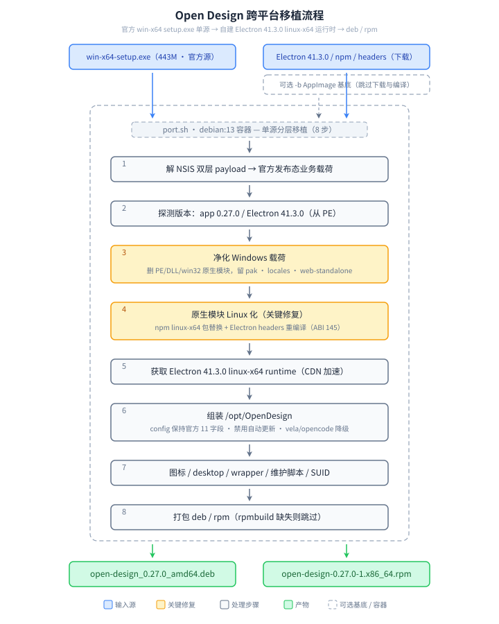

# Open Design — 跨平台移植脚本（port.sh）

> 将 Open Design 的 Windows x64 官方发布包移植到 Linux，重新打包为 **deb / rpm**。
>
> 本案例是 [port-linux](../README.md) 移植工具集收录的移植方案之一。

Open Design 0.27.0 官方只发布 macOS（arm64 / x64 DMG）与 Windows（x64 NSIS exe）安装包，
**没有 Linux 包，也没有官方 AppImage**。本脚本固定以 Windows x64 setup.exe 为唯一源：
从 NSIS 双层 payload 中提取官方发布态业务代码，删除 Windows PE 与 win32 原生模块并替换为
Linux 等价物，用 Electron 41.3.0 linux-x64 runtime 启动，重新打包为 deb / rpm。

## 背景：为什么需要移植

Open Design 是开源项目（Apache-2.0，[`nexu-io/open-design`](https://github.com/nexu-io/open-design)），
但官方并未发布 Linux 构建。用 `pnpm exec tools-pack linux build --to appimage` 自行构建出的
Linux AppImage 往往**无法正常使用**——它其实是一个**开发态半成品组装**，与官方发布态
组装不是同一套东西。实测 0.27.0 两者差异：

| | 官方 Windows 发布包 | 自建 Linux AppImage |
|---|---|---|
| `resources/app/main.cjs` | `import("./prebundled/packaged-main.mjs")` | `import("@open-design/packaged")` |
| `resources/app/prebundled/` | ✅ 101 项（daemon-cli / daemon-sidecar / web-sidecar / packaged-main） | ❌ 缺失 |
| `resources/open-design-web-standalone/` | ✅ 11631 项（Next.js standalone，UI 所在） | ❌ 缺失 |
| `open-design-config.json` | 11 字段（含 3 个 sidecar 入口 + `webOutputMode`） | 仅 3 字段 |
| Linux 运行时 | — | ✅ Electron 41.3.0 ELF、内置 Node v24.22.2、vela、opencode、Linux 原生模块、官方图标 |

也就是说：**坏的是业务载荷，完好的恰好是 Linux 运行时**。因此本方案以官方 Windows
发布态载荷为准，Linux 运行时由脚本自建（从 npm 下载 Electron 41.3.0 linux-x64 与各平台包）；
`-b` 可选开关则允许只复用那个 AppImage 的 Linux ELF、丢弃其损坏的业务载荷。

架构上桌面端确实是 **Electron**（`Open Design.exe` / Linux 侧 `Open Design` ELF 均为
Electron 41.3.0 / Chrome 146.0.7680.188），但 Electron 只是窗口壳：`main.cjs` 拉起
**daemon sidecar**（`ELECTRON_RUN_AS_NODE=1`，用 Electron 内置 Node 跑）与
**Next.js web standalone**，界面其实是网页。这也是 `bin: od`、`od mcp install`、
`pnpm tools-dev run web` 等用法能脱离 Electron 运行的原因。

## 移植原理

`port.sh` 自包含全部逻辑，共 8 步：



1. **解 NSIS 双层 payload**：`7z x` 取出 `$PLUGINSDIR/payload-base.7z`（382M，26856 条目）
   与 `payload-overlay.7z`（81M，仅 3 文件）。先解 base 得到完整 `resources/`，再用
   overlay 覆盖 `Open Design.exe`、`app/package.json`、`open-design-config.json`。
   校验 `prebundled/packaged-main.mjs` 与 `open-design-web-standalone/` 存在，防止拿错包。
2. **探测版本**：从 config 读 `appVersion`（0.27.0）；从 PE 的 `strings` 提取
   `Electron/41.3.0`，动态构造 runtime 下载地址，避免版本硬编码。
3. **净化 Windows 载荷**：删除全部 `*.exe` / `*.dll` / `*.pdb` 与 win32 / darwin 原生模块目录，
   保留 `*.pak`、`icudtl.dat`、`locales/`、全部 `resources/**`；移除 `app-update.yml`
   禁用自动更新；`onnxruntime-node` 保留包内自带的 `linux/x64` NAPI 预编译。
4. **原生模块 Linux 化（关键修复）**：见下节。
5. **获取 Electron runtime**：下载 `electron-v41.3.0-linux-x64.zip`（`IS_CHINA=1` 走 CDN），
   解压后主程序改名为 `Open Design`，删 `default_app.asar`，`chrome-sandbox` 置 SUID 4755。
6. **组装 `/opt/OpenDesign`**：Linux runtime 顶层 + 官方 Windows `resources/` 业务载荷；
   `open-design-config.json` **保持官方原值不改**（`namespace` 参与 launcher payload
   一致性校验，改动风险大于收益）；vela / opencode 按下方降级策略处理。
7. **桌面入口**：`/usr/bin/open-design` wrapper（注入 `LD_LIBRARY_PATH`）、
   `.desktop`（`StartupWMClass=Open Design`）、hicolor 多尺寸图标、
   `postinst` 重设 SUID、DEP-5 copyright。
8. **打包**：`build_deb`（含 `DEBIAN/md5sums` 供 `dpkg -V` 校验）；`rpmbuild` 可用时打 rpm，
   缺失则跳过。

### 原生模块 Linux 化

Windows 发布态包里的 `better-sqlite3` / `node-pty` 是**精简包**（只有预编译 `.node`，
没有 `binding.gyp` 与 `src/`），无法本机编译；`prebuild-install` 也找不到匹配的预编译。
脚本分两类处理：

| 模块 | 处理方式 |
|---|---|
| `@img/sharp-linux-x64` + `@img/sharp-libvips-linux-x64` | 从 `sharp` 的 `optionalDependencies` 解析版本，下载 linux-x64 平台包覆盖 |
| `@esbuild/linux-x64`、`@ffmpeg-installer/linux-x64` | 同上，从各自主包的 `optionalDependencies` 解析 |
| `better-sqlite3`、`node-pty` | 下载**同版本完整 npm 包**替换精简包，再用 `node-gyp` 本机编译 |
| `onnxruntime-node` | 包内已自带 `linux/x64` NAPI 预编译，删 win32/darwin 目录即可 |
| `blake3-wasm`、`gsap`、`hyperframes`、`@open-design/*` | 平台无关的 JS / WASM，原样保留 |

**必须用 Electron headers 编译**：系统 Node 20 的 `NODE_MODULE_VERSION` 为 115，
Electron 41 内置 Node 24 为 145；用系统 headers 编译的 `.node` 会在 Electron 里报
ABI 不匹配。脚本通过 `fetch_electron_headers()` 取
`artifacts.electronjs.org/headers/dist/v<ver>/...`，以 `--nodedir` 传给 `node-gyp`；
下载失败才回退系统 headers 并告警。实测编译产物在 `ELECTRON_RUN_AS_NODE=1` 下
`better-sqlite3`、`node-pty`、`sharp` 均可正常加载。

## 构建（Docker debian:13）

移植统一在 `port-linux-base` 容器（`debian:13`）内执行，不依赖宿主环境。按仓库根
[`AGENTS.md`](../AGENTS.md) 的「0. Docker 运行环境」：

```bash
# 1) 在仓库根目录构建统一基础镜像（一次即可）
docker build -t port-linux-base .
# 非中国网络：docker build --build-arg IS_CHINA=0 -t port-linux-base .

# 2) 源包放入 open-design/ 目录后执行
cd open-design/
docker run --rm -v "$PWD":/src port-linux-base ./port.sh -p deb
```

也可用仓库根 [`justfile`](../justfile)：

```bash
just image                     # 构建基础镜像
just port open-design -p deb   # 通用配方
just open-design -p deb        # 本案例快捷配方
```

> **磁盘**：源包解开后约 1.5G，加上 Electron runtime 与 deb 产物，构建峰值约 3G。
> 若案例目录所在分区空间不足，可用 `-e BUILD_ROOT=<有空间的目录>` 把中间产物与
> `build/` 挪走（例如 `-e BUILD_ROOT=/tmp/od-build -v /tmp/od-build:/tmp/od-build`）。

## 用法

```bash
# 最简：自动探测当前目录 open-design-*-win-x64-setup.exe，按当前 OS 打包
./port.sh

# 只打 deb / 同时打 deb 与 rpm（需 rpmbuild）
./port.sh -p deb
./port.sh -p all

# 显式指定源包，或从 URL 自动下载
./port.sh -s ./open-design-0.27.0-win-x64-setup.exe
./port.sh -s "https://releases.open-design.ai/stable/versions/0.27.0/open-design-0.27.0-win-x64-setup.exe"

# 复用自建 AppImage 的 Linux ELF 运行时（跳过 Electron 下载与原生模块编译，
# 同时可得到官方图标、内置 vela / opencode，消除全部降级项）
./port.sh -b ./open-design-0.27.0-linux-x64.AppImage

# 覆盖 Electron 版本 / 指定官方图标
./port.sh -e 41.3.0 -i ./icon.png
```

### 参数

| 参数 | 说明 |
|---|---|
| `-p, --platform rpm\|deb\|all` | 构建目标；省略时按当前 OS 自动检测（Fedora 系 → rpm，Debian 系 → deb） |
| `-s, --source PATH\|URL` | 源安装包（win-x64 setup.exe）；本地路径或 `http(s)://` 地址；省略时自动探测当前目录 `open-design-*-win-x64-setup.exe` |
| `-b, --base PATH` | 可选 Linux AppImage 基底：复用其 Linux ELF 运行时，丢弃其业务载荷 |
| `-e, --electron VERSION` | Electron runtime 版本；省略时从源包 PE 自动探测 |
| `-i, --icon PATH` | PNG 图标；省略时优先取 `-b` 基底的官方图标，否则生成渐变占位图 |
| `-h, --help` | 显示帮助（未知参数也会先打印帮助到 stderr 再退出） |

### 环境变量

| 变量 | 说明 |
|---|---|
| `DEBUG=1` | 调试模式（`set -eux`，打印每条命令） |
| `IS_CHINA=1` | 中国网络：GitHub 系下载走 CDN（默认 `https://fastfile.asfd.cn/`），npm 走镜像 |
| `CDN=<url>` | 覆盖 CDN 前缀 |
| `BUILD_ROOT=<dir>` | 覆盖构建工作目录（默认 `<脚本目录>/build`） |
| `EXPECTED_SHA256=<hex>` | 期望的源包 sha256；也可在源包旁放同名 `.sha256` 文件 |
| `VELA_BIN=<path>` / `OPENCODE_BIN=<path>` | 自备 Linux 版 vela / opencode，消除对应降级项 |
| `NPM_CONFIG_REGISTRY` / `NPM_CONFIG_USERCONFIG` | npm 镜像配置 |

## 产物

```
build/
├── cache/    # Electron runtime / headers / npm tgz 下载缓存，跨次复用
└── out/
    ├── open-design_0.27.0_amd64.deb
    └── open-design-0.27.0-1.x86_64.rpm   # 需 rpmbuild
```

安装布局：

```
/opt/OpenDesign/
├── Open Design            # Electron 41.3.0 Linux 主程序（ELF）
├── chrome-sandbox         # SUID 4755
├── locales/, *.pak, *.so  # Linux Electron runtime
└── resources/
    ├── app/               # main.cjs + prebundled/ + node_modules（已 Linux 化）
    ├── open-design/       # skills / design-systems / templates / plugins / bin/
    ├── open-design-web-standalone/   # Next.js standalone UI
    └── open-design-config.json       # 官方 11 字段，原值保留
/usr/bin/open-design                 # 启动 wrapper
/usr/share/applications/open-design.desktop
/usr/share/icons/hicolor/<size>/apps/open-design.png
```

安装：

```bash
sudo apt install ./open-design_*.deb      # Debian/Ubuntu
sudo dnf install ./open-design-*.rpm      # Fedora/RHEL
```

清理全部中间产物：`rm -rf build/`。

## 依赖

容器镜像已预装全部前置依赖（见根 [`Dockerfile`](../Dockerfile)）。本地直跑需：

```bash
# Debian/Ubuntu（含 debian:13 容器）
sudo apt install 7zip unzip tar binutils file nodejs npm python3 build-essential dpkg-dev curl
# 打 rpm 另需 rpmbuild（Debian 仓库不提供）
```

- `7z`：解 NSIS 双层 payload（`payload-base.7z` / `payload-overlay.7z`）
- `strings`（`binutils`）：从 PE 探测 Electron 版本
- `file`：识别 PE / ELF 残留
- `node` + `npx`：运行 `node-gyp` 编译原生模块
- `python3`：解析 `package.json` / `optionalDependencies`、生成占位图标
- `g++` + `make`（`build-essential`）：编译 `better-sqlite3` / `node-pty`
- `dpkg-deb`：打 deb（缺失时降级 `ar` + `xz`）

## 来源

- 官方下载页：<https://open-design.ai/download>
- 官方源包直链（0.27.0 x64）：
  <https://releases.open-design.ai/stable/versions/0.27.0/open-design-0.27.0-win-x64-setup.exe>
  - 大小 443 MiB（464,548,859 字节）
  - sha256 `5db2df6620958f1bfa632aee42be2593c0b5cb34f1799347e892a3e6285ce8a6`
- 上游仓库：<https://github.com/nexu-io/open-design>（Apache-2.0）
- Electron 发布包：<https://github.com/electron/electron/releases/tag/v41.3.0>
- Electron headers：<https://artifacts.electronjs.org/headers/dist/v41.3.0/>

## 已知限制

- **非官方 Linux 版本**：上游不提供 Linux 包，也不提供自动更新（`app-update.yml` 已移除）；
  `namespace` 沿用官方 `release-stable-win`。
- **vela 无公开 Linux 构建**：云同步 / 遥测相关功能不可用。可用 `VELA_BIN` 自备，
  或 `-b` 复用自建 AppImage 内的 Linux `vela`。
- **内置 opencode 不可用**：agent 兜底功能降级；可在 PATH 安装 opencode、设 `OPENCODE_BIN`，
  或 `-b` 复用 AppImage 内置二进制（应用也会查 `~/.opencode/bin`）。
- **占位图标**：默认生成渐变占位 PNG；用 `-i` 指定官方图标，或 `-b` 复用 AppImage 内的
  官方多尺寸图标。
- **sharp 兼容性警告**：Electron Linux 下加载 sharp 会打印
  `[SharpElectronLinux] Warning`，实测功能正常，非致命。
- 仅支持 **x86_64（amd64）**；arm64 需另取 arm64 Electron runtime 与对应原生包。
- 容器内无 `rpmbuild`，`-p all` 的 rpm 部分自动跳过（deb 正常产出）。
- 上游升级 Electron 主版本后，脚本会自动按 PE 探测版本并下载对应 runtime 与 headers；
  若原生模块 ABI 变化导致编译失败，会在构建摘要中列为降级项。

## 许可

打包脚本以 Apache 2.0 许可；Open Design 应用与资源归 Nexu IO / Open Design
贡献者所有，同为 Apache-2.0。本项目与上游无隶属关系，公开分发前请确认上游条款允许。
