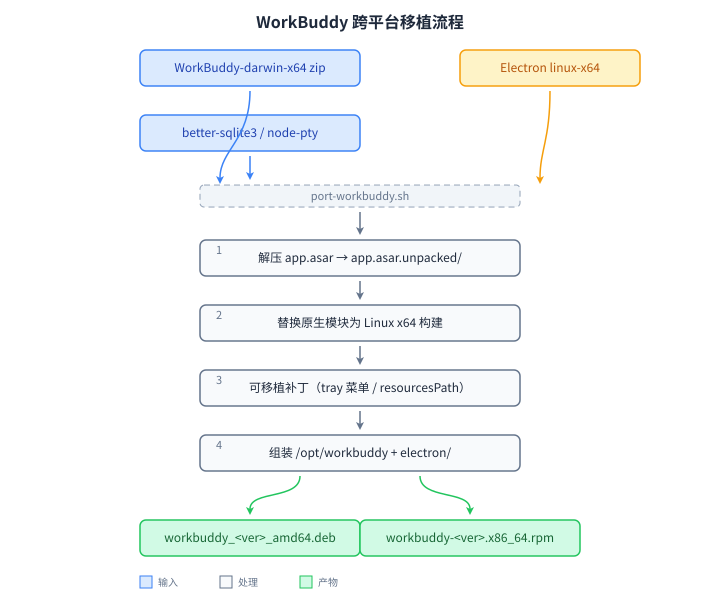

# WorkBuddy — 跨平台移植脚本（port.sh）

> 将腾讯 WorkBuddy 的 macOS 新版移植到 Linux，重新打包为 **deb / rpm**。
> 参考 AUR [`workbuddy`](https://aur.archlinux.org/packages/workbuddy) 配方与
> [`forkdo/workbuddy-linux`](https://github.com/forkdo/workbuddy-linux) 的构建逻辑。
>
> 本案例是 [port-linux](../README.md) 移植工具集收录的移植方案之一。

腾讯 WorkBuddy 目前没有官方 Linux 客户端，官方 Linux 版旧包更新缓慢。本脚本采用
**基底合并**模式：以官方 Linux 版旧包（deb 优先，rpm 兼容）为基底，合并 macOS 新版
zip（`WorkBuddy-darwin-x64-<ver>.zip`）的 `app.asar` 与应用资源，复用基底的
Electron 运行时与 Linux 原生模块，将依赖平台的 `better-sqlite3`、`sandbox`、
`node-pty`、`koffi`、`ripgrep` 等替换为 Linux 构建，重新打包为 deb / rpm。

## 移植原理

`port.sh` 自包含全部逻辑，共 6 步：



1. **解基底包**：`dpkg-deb -x` 解官方 Linux deb（rpm 基底走 `rpm2cpio`），得到完整
   Linux 运行时（Electron 37、原生模块、`resources/runtime`），并解出官方维护脚本。
2. **解新版 Darwin zip**：解压 `app.asar`（unpacked 缺失点文件自动预补占位）。
3. **合并**：新版 `app.asar` / `app.asar.unpacked` / Resources 顶层资产
   （`workbuddy-editor-sdk-supervisor` 等 daemon 硬校验文件）替换基底对应内容。
4. **Linux 化（关键修复）**：`better-sqlite3`、`genie-trash`、`ripgrep` 从基底回填
   Linux ELF；`sandbox`、`node-pty`、`koffi` 按新版自动探测版本并从 npm 的
   linux-x64 包覆盖；清理残余 Mach-O；应用 tray 等可移植性补丁。
5. **组装**：复用基底 Electron 目录树，生成 desktop（对齐官方字段）、多尺寸图标、
   `/usr/bin/workbuddy` wrapper、`chrome-sandbox` SUID。
6. **打包**：deb 复用官方维护脚本（`preinst`/`prerm` 优雅结束残留进程、`postinst`
   刷新图标与 desktop 缓存、`postrm` 清理）并生成 `md5sums`；rpm 需 `rpmbuild`。

前提：新版 zip 内置的 Electron 需与基底一致（当前 5.8.3 zip 与 5.6.2 基底均为
37.10.3，原生 ABI 完全匹配）；若上游升级 Electron 主版本，需等官方 Linux 版更新后
更换基底。

安装布局（deb / rpm 一致）：

```
/opt/WorkBuddy/               # 基底 Electron 运行时 + 合并后的新版应用资源
├── workbuddy                 # Electron 主程序（基底 Linux ELF）
├── chrome-sandbox, locales, *.pak, *.so
└── resources/
    ├── app.asar(.unpacked)   # Darwin 新版业务代码（原生模块已 Linux 化）
    └── runtime/              # 基底自带 python 等运行时
/usr/bin/workbuddy            # 启动 wrapper: exec /opt/WorkBuddy/workbuddy
/usr/share/applications/workbuddy.desktop
/usr/share/icons/hicolor/<size>/apps/workbuddy.png
```

## 构建（Docker debian:13）

移植统一在 `debian:13` 容器内执行，不依赖宿主环境：

```bash
cd workbuddy/

# 源包就位（当前目录自动探测）
#   WorkBuddy-darwin-x64-<ver>.zip          # macOS 新版，来源见下文「来源」
#   WorkBuddy-linux-x64-deb-<ver>.deb       # Linux 基底旧版

docker run --rm \
  -v "$PWD:/src" -v "$HOME/.npmrc:/root/.npmrc:ro" \
  -w /src/workbuddy \
  debian:13 bash -c '
    sed -i "s|deb.debian.org|mirrors.tuna.tsinghua.edu.cn|g" /etc/apt/sources.list.d/debian.sources
    apt-get update -qq
    apt-get install -y -qq --no-install-recommends ca-certificates curl unzip file nodejs npm
    ./port.sh -p deb
  '
```

- 前置依赖清单及说明见仓库根 [`AGENTS.md`](../AGENTS.md)
- 挂载 `~/.npmrc`（或设 `NPM_CONFIG_USERCONFIG`）使 sandbox / koffi 等 npm 包走镜像
- 容器内无 `rpmbuild`（Debian 仓库不提供），`-p all` 的 rpm 部分会自动跳过

## 用法

```bash
# 最简：自动探测当前目录的 WorkBuddy-darwin-x64-*.zip 与
# WorkBuddy-linux-x64-deb-*.deb（缺失时回退 *-rpm-*.rpm），按当前 OS 打包
./port.sh

# 同时生成 deb 和 rpm（需 rpmbuild）
./port.sh -p all

# 显式指定源 zip 与基底 deb
./port.sh -p deb -b WorkBuddy-linux-x64-deb-5.6.2.40046327-c7b525f3.deb \
  WorkBuddy-darwin-x64-5.8.3.41334564-db0e9b51.zip

# 从 URL 下载源（文件名须含版本号）
./port.sh -s "https://download.codebuddy.cn/.../WorkBuddy-darwin-x64-5.8.3.41334564-db0e9b51.zip"

# 覆盖 Electron 版本（未使用，基底已含运行时，仅作信息）
./port.sh -e 37.10.3
```

### 参数

| 参数 | 说明 |
|---|---|
| `-p, --platform rpm\|deb\|all` | 构建目标；省略时按当前 OS 自动检测（Fedora 系 → rpm，Debian 系 → deb） |
| `-s, --source PATH\|URL` | 源 zip：本地路径或 `http(s)://` 下载地址；省略时自动探测当前目录 `WorkBuddy-darwin-x64-*.zip` |
| `-b, --base PATH` | 基底包（`.deb` / `.rpm`）；省略时自动探测 `WorkBuddy-linux-x64-deb-*.deb`（优先）或 `WorkBuddy-linux-x64-rpm-*.rpm` |
| `-e, --electron VERSION` | Electron runtime 版本（未使用，基底已含运行时，仅作信息） |
| `-v, --pkgver VERSION` | 上游版本号；省略时从源文件名提取（如 `5.8.3.41334564`） |
| `<*.zip>` / `<*.deb>` / `<*.rpm>` | 位置参数：分别指定源 zip / 基底包路径 |

### 自动探测

不指定 `-s` 时，脚本在当前目录按 glob `WorkBuddy-darwin-x64-*.zip` 查找源文件；
不指定 `-b` 时优先探测 `WorkBuddy-linux-x64-deb-*.deb`，缺失再探测 `*-rpm-*.rpm`。
版本号从文件名提取：`WorkBuddy-darwin-x64-5.8.3.41334564-db0e9b51.zip` →
版本 `5.8.3.41334564`，hash `db0e9b51`。

- deb `Version`: `5.8.3.41334564-db0e9b51`
- rpm `Version`/`Release`: `5.8.3.41334564` / `1.db0e9b51`

## 产物

```
build/
├── cache/    # npm 下载缓存（sandbox、koffi、node-pty tgz），跨次复用
└── out/
    ├── workbuddy_5.8.3.41334564-db0e9b51_amd64.deb
    └── workbuddy-5.8.3.41334564-1.db0e9b51.x86_64.rpm   # 需 rpmbuild
```

临时工作目录构建后自动清理；全部中间产物删除：`rm -rf build/`。

安装：

```bash
# Debian/Ubuntu
sudo apt install ./workbuddy_*.deb

# Fedora/RHEL
sudo dnf install ./workbuddy-*.rpm
```

安装后从应用菜单启动 WorkBuddy，或终端运行 `workbuddy`。

## 依赖

容器内构建的完整前置依赖见仓库根 [`AGENTS.md`](../AGENTS.md)，本地直跑需：

```bash
# Debian/Ubuntu（含 debian:13 容器）
sudo apt install ca-certificates curl unzip file nodejs npm
# 使用 rpm 基底时另需（dpkg-deb 随 dpkg 自带）
sudo apt install rpm cpio

# Fedora
sudo dnf install unzip tar file nodejs npm curl rpm-build rpm2cpio cpio
```

- `unzip`、`tar`：解压 zip / tgz
- `node` + `npx`：通过 `asar@3.2.0` 解压 `app.asar`
- `curl` 或 `wget`：下载源 / 原生模块
- `dpkg-deb`：解 deb 基底、打 deb（缺失则跳过 deb）
- `rpm2cpio` + `cpio`：仅解 rpm 基底时需要
- `rpmbuild`：打 rpm（缺失则跳过 rpm）

## 来源

- 官方产品页：<https://www.workbuddy.cn/app>
- macOS x64 源 zip 下载地址：<https://copilot.tencent.com/v2/update?platform=workbuddy-darwin-x64>
  （格式：`WorkBuddy-darwin-x64-5.8.3.41334564-db0e9b51.zip`）
- Linux deb 基底下载地址：<https://copilot.tencent.com/v2/update?platform=workbuddy-linux-x64-deb>
  （格式：`WorkBuddy-linux-x64-deb-5.6.2.40046327-c7b525f3.deb`）
- AUR 参考包：<https://aur.archlinux.org/packages/workbuddy>
- 原始构建脚本参考：[`forkdo/workbuddy-linux`](https://github.com/forkdo/workbuddy-linux)

## 已知限制

- 这是从 macOS 资源移植的非官方版本，部分依赖 macOS 的功能可能不可用。
- 上游界面更新可能使兼容补丁失效。
- 仅支持 x86_64（amd64）；arm64 需 `darwin-arm64` 源 zip 与对应原生模块。
- 新版 zip 的 Electron 需与基底一致（当前均为 37.10.3），上游升级 Electron 主版本后
  需等待官方 Linux 版更新、更换基底。
- IM 集成资产（`workbuddy-editor-sdk-supervisor`、`resources/im-backend-cmd/im-napi.node`、
  `@genie/im-channels-native` 内 `ImSDKForMac.framework` 等）官方仅有 Mach-O 构建，Linux
  无对应产物。daemon 启动对它们做硬性存在性校验，脚本保留 macOS 二进制占位以放行启动，
  故应用可正常运行但 IM 集成功能在 Linux 上不可用。
- 基底包自带的 `resources/runtime/python` 缺少 `bin/python3`，启动日志中的
  `[VendorExtract] python: packaged runtime ... missing bin/python3` 为基底自带问题，非致命。
- 安装路径固定为 `/opt/WorkBuddy`；daemon 代码依赖 Electron 原生
  `process.resourcesPath`（即 `/opt/WorkBuddy/resources`）解析资产，不做路径字面量替换。

## 许可

打包脚本以 Apache 2.0 许可。WorkBuddy 应用、商标及资源归腾讯或相应权利人所有，
本项目与腾讯无隶属关系。公开分发前请确认上游条款允许。
